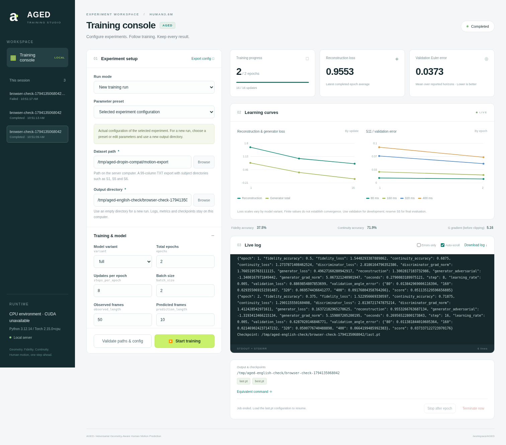

# Local training dashboard

The dashboard runs on the training computer, using its current Python environment and the existing AGED trainer. No extra Web framework, Node build or external CDN is required. CLI interfaces and integration v1 checkpoints remain compatible.



The screenshot shows a real synthetic-data CPU run in local Chromium with small test settings. Its error values are not Human3.6M or paper results.

## Start the dashboard

Activate the existing training environment and enter the repository root:

```bash
python -m aged.web --open
```

Open `http://127.0.0.1:8765`. Omit `--open` to open the browser manually; use `python -m aged.web --port 8766` if the port is occupied. Windows and Linux use the same command. No GPU PyTorch reinstall is needed. With the README's editable installation, updating source is enough to run this module. Updating the installation also registers the `aged-web` command.

The server listens only on `127.0.0.1`; it has no public-network login or remote deployment mode. Dataset paths refer to the **computer running the server**, rather than an upload into the browser:

- Windows: dataset `D:/datasets/h36m`, output `D:/experiments/aged-p0-A`.
- Linux: dataset `/mnt/data/h36m`, output `/mnt/experiments/aged-p0-A`.
- Relative paths resolve from the server's launch directory, shown in the page footer.

The directory browser supports local folders and Windows drives. The checkpoint browser accepts `.pt` / `.pth`. Keep output separate from data; a new run needs an empty or nonexistent output directory.

## Configure and start training

1. Choose a run mode. Use **New training run** initially.
2. The default **P0 · Quick SGD check** uses SGD, LR 0.005, S11 validation, 2x1000 updates and a snapshot each epoch. Compatibility short/long presets retain Adam. The team profile changes several settings at once. A preset does not establish reproduction accuracy.
3. Enter the dataset root and a new output directory. The contract remains 99-column, 50 Hz exponential-map TXT such as `S1/walking_1.txt`. BVH/CDF are not read directly.
4. Expand the four parameter groups to edit every Config field: model, G/D optimizers/rates, sampling, actions, validation, snapshots, device and logging. An unset D optimizer/rate follows G.
5. Click **Validate paths & config** to check configuration, device, directories and required training/validation file presence. Contents and normalization are checked in the training process. Training does not need S5; final evaluation does.
6. Click **Start training**. Each server allows one training job at a time. Training runs in an isolated subprocess so the dashboard stays responsive.

Export the complete `config.json` or inspect the equivalent CLI command. The exported JSON works as CLI `--config`, with separate `--root` and `--out` arguments.

Device accepts `cuda`, `cuda:0`, `cpu`, `auto` or `mps`. Detection uses the Python running the server. Without CUDA the initial selection is CPU; another conda/venv environment's capabilities do not apply.

TensorBoard and wandb remain optional. Dashboard charts and logs work with `track=none` and do not require either package.

## Logs, curves and errors

- Real batch metrics are emitted about every 0.5 seconds; the browser polls about once per second. During loading, normalization and model initialization, watch the log until the first update arrives.
- The left chart shows up to 600 recent sampled reconstruction/generator-total points, rather than every batch. The raw console log retains complete emitted progress events.
- The right chart shows validation error by completed epoch and reported horizon, such as 80/160/320/400 ms. It shows an explanation when validation is disabled or incomplete.
- The reconstruction card shows the latest batch while running and the last epoch average after completion. G gradient norms are measured before clipping.
- stdout/stderr are combined. Failures highlight recent exceptions and retain the full Python traceback. **Errors only** locates error lines; disable it for full context.
- The page keeps up to 3000 recent ordinary log lines. **Download log** includes full stdout/stderr and structured progress events.
- States distinguish training, stopping, completed, saved-and-stopped, failed and terminated. A nonzero worker exit is not reported as success.

MSE and geodesic-sum magnitudes are not directly comparable. Finite losses, approximately 50% critic accuracy or absence of exceptions do not alone establish learning quality. See the [GPU training guide](GPU_TRAINING_GUIDE.md) for development comparisons and priorities.

## Checkpoints and stopping

- `last.pt`: overwritten after each completed epoch.
- `best.pt`: updated on validation improvements when validation is enabled.
- `save_every=N`: additionally retains historical `epoch_005.pt`-style snapshots; 0 disables them.
- **Stop after epoch**: finishes this epoch, validation and checkpoint saving before exiting. No partial-epoch checkpoint format is introduced, so normal resume remains valid.
- **Terminate now**: after browser confirmation, terminates the worker and discards unsaved updates in this epoch. Earlier completed checkpoints remain.

Closing or refreshing the browser does not stop training; reopening the same server restores this session's job view. Ctrl+C in the server terminal exits the server and terminates active training. Resume from an already completed checkpoint. Prefer stopping after an epoch before exiting the server. Use `num_workers=0` for initial checks.

## Resume and warm start

Select **Resume**, enter `last.pt`, then click **Load checkpoint config**. Training settings lock; total epochs must exceed the saved epoch. Device, threads/workers, tracking backend, project, patience and snapshot interval remain editable. Confirm the same dataset and output directory before starting. Saved validation history is loaded, and the existing trainer restores models, optimizers, update count and RNG.

**Warm start** loads a source configuration and permits applicable changes in a **new empty output directory**. It retains G and its optimizer and initializes fresh critics. G optimizer type, features and normalization must match. It does not convert Adam optimizer state to SGD or directly change data splits/input dimensions during resume.

Restarting the server does not reconnect old processes or automatically reload earlier session lists. Saved files remain available for checkpoint-based resume. Multiple independent servers bypass the single-server job limit; start with one server.

## Saved files

The selected experiment directory retains the existing `config.json`, `normalisation.json`, `commands.txt`, `results.json` and checkpoints.

Additional job records live in `experiments/web-ui/<job-id>/`:

| File | Contents |
| --- | --- |
| `request.json` / `config.json` | Paths, mode, full settings and replayable command arguments |
| `console.log` | Persistent stdout, exceptions and structured progress events |
| `session.json` | Status, timestamps, exit code, output path and error summary |
| `stop` | This job's request to stop after saving an epoch |

These artifacts live under Git-ignored experiments. `--state-dir` changes the dashboard record directory. Keep active job directories intact. Model recovery uses the existing checkpoint and corresponding dataset, with no new checkpoint conversion.

## Validation scope

System tests use actual HTTP requests to launch production training subprocesses and check saved-epoch stopping, resume, CPU parameter equality with normal CLI training, path checks, task exclusion, tracebacks, log downloads and termination. Local Chromium tests operate the real form and training workflow.

The development machine lacks CUDA and real Human3.6M recordings. Synthetic CPU exports validate interface/process behavior. Real GPU learning quality, drivers and native Windows interaction still need checks on the training computer; these engineering checks do not establish paper reproduction.
